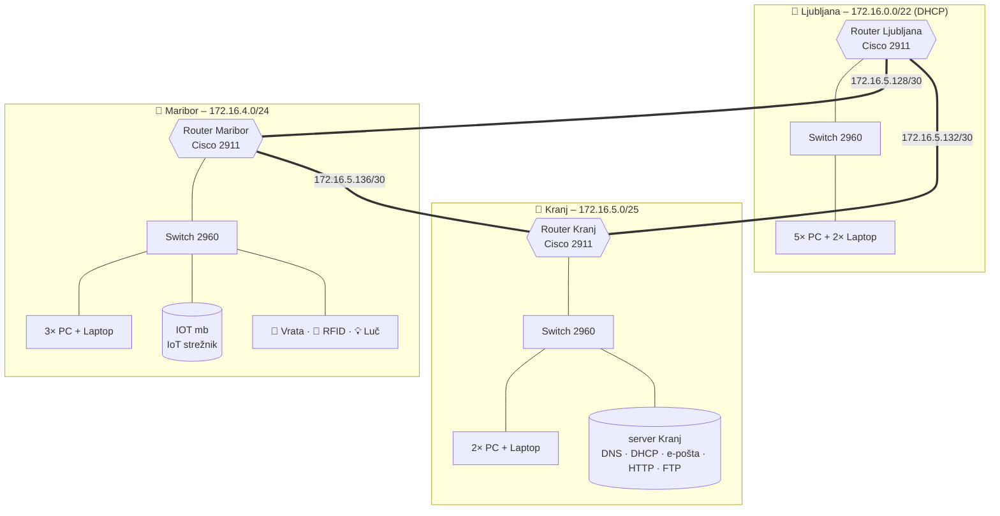

[README Simulacija omrezja.md](https://github.com/user-attachments/files/34877113/README.Simulacija.omrezja.md)
# 🌐 Simulacija omrežja: podjetje na treh lokacijah

> Načrt in simulacija poslovnega omrežja s tremi poslovalnicami (**Ljubljana**, **Kranj**, **Maribor**), izdelana v **Cisco Packet Tracer 8.2.2**.
> *Network simulation: design of a company network with three branches (**Ljubljana**, **Kranj**, **Maribor**), built in **Cisco Packet Tracer 8.2.2**.*


**Jezik / Language:** [🇸🇮 Slovensko](#-slovensko) · [🇬🇧 English](#-english)

---

## 🇸🇮 SLOVENSKO

### 📖 Opis

Projekt prikazuje **omrežje izmišljenega podjetja** (domena `ronco.com`) s tremi poslovalnicami po Sloveniji. Vsaka poslovalnica ima svoj usmerjevalnik, stikalo in končne naprave. Usmerjevalniki so med seboj povezani v **trikotno (redundantno) topologijo**, poti pa si izmenjujejo z dinamičnim usmerjanjem **OSPF**.

| Lokacija | Vloga | Posebnosti |
|---|---|---|
| 🏢 **Ljubljana** | sedež podjetja (*Corporate Office*) | največje omrežje (/22), naslovi se dodeljujejo prek **DHCP** |
| 🏬 **Kranj** | poslovalnica s **strežniško sobo** | centralni strežnik: DNS, DHCP, e-pošta, HTTP/HTTPS, FTP, NTP, Syslog |
| 🏬 **Maribor** | poslovalnica s **pametnim nadzorom vstopa** | IoT strežnik, RFID čitalnik, pametna vrata in luč |

### 🎯 Namen projekta

Načrtovati in v simulatorju preizkusiti celovito omrežje manjšega podjetja: smiselno razdelitev naslovnega prostora, usmerjanje med lokacijami, centralizirane omrežne storitve, varen oddaljeni dostop do opreme in primer uporabe interneta stvari (IoT) za nadzor dostopa.

---

### ✨ Funkcionalnosti

#### 🔀 Usmerjanje in naslavljanje
- **VLSM** razdelitev zasebnega omrežja `172.16.0.0/16` na podomrežja različnih velikosti glede na potrebe lokacije.
- **Point-to-point povezave /30** med usmerjevalniki.
- **OSPF** (proces 1, *area 0*) na vseh treh usmerjevalnikih. Ob izpadu ene povezave promet samodejno steče po drugi poti.

#### 🖧 Omrežne storitve (strežnik *server Kranj*, 172.16.5.5)
- **DNS:** A-zapisi za naprave v Kranju in Mariboru (`krpc1`, `krpc2`, `krlaptop`, `mbpc1`, `mbpc2`, `mbpc3`, `mblaptop`), kar omogoča dostop po imenu namesto po IP naslovu.
- **DHCP:** bazen `LjubljanaBazen` (172.16.0.2–172.16.2.1, prehod 172.16.0.1, DNS 172.16.5.5). Ljubljanski usmerjevalnik zahteve posreduje strežniku v Kranju z ukazom **`ip helper-address`** (*DHCP relay*), zato DHCP strežnik ni na isti lokaciji kot odjemalci.
- **E-pošta (SMTP + POP3)** za domeno `ronco.com` s tremi uporabniškimi računi. Odjemalca sta nastavljena na `KR - PC1` in `MbPC2`; preizkušena je izmenjava sporočil med Kranjem in Mariborom.
- **HTTP / HTTPS, FTP, TFTP, NTP in Syslog.**

#### 🔐 Varnost in upravljanje
- **SSH** za oddaljeni dostop do vseh usmerjevalnikov (`transport input ssh`, lokalni uporabniški računi `login local`, na Ljubljani izrecno **SSH v2**). Telnet je onemogočen.
- Šifrirana **enable secret** gesla in uporabniški računi s `secret` (MD5 hash).
- Domena `ronco.com` nastavljena na usmerjevalnikih (potrebna za generiranje RSA ključev za SSH).

#### 🏠 IoT – pametni nadzor vstopa (Maribor)
- **IoT strežnik** (*IOT mb*, 172.16.4.6) z vklopljeno storitvijo *IoT Registration Server*; nanj so registrirani pametna vrata, RFID čitalnik in luč.
- **Dve RFID kartici:** *Pravilna kartica* (Card ID = 1) in *Napačna kartica* (Card ID = 2).
- **Štiri pravila (IoT rules):**

| Pravilo | Pogoj (IF) | Dejanje (THEN) |
|---|---|---|
| **Odpri vrata** | RFID → Card ID = 1 | vrata → *odklenjeno* |
| **Zakleni** | RFID → Card ID ≠ 1 | vrata → *zaklenjeno* |
| **Prižgi luč** | vrata → *odprta* | luč → *vklopljena* |
| **Ugasni luč** | vrata → *zaprta* | luč → *izklopljena* |

#### 🗺️ Fizični pogled
- Naprave so razporejene po **fizičnih lokacijah** Packet Tracerja (*Intercity → mesto → stavba → omara → rack*): Ljubljana (*Corporate Office, Main Wiring Closet*), Kranj in Maribor (*Office Building, Wiring Closet*).
- V vsaki omari je **razdelilnik napajanja** (*Power Distribution Device*), na katerega sta priključena usmerjevalnik in stikalo.
- Na logični shemi so **opombe** z IP naslovi naprav in podatki o lokaciji.

---

### 🗺️ Topologija



---

### 📋 IP načrt (VLSM)

| Omrežje | Naslov / maska | Prehod | Uporabnih naslovov | Dodeljevanje |
|---|---|---|---|---|
| LAN Ljubljana | `172.16.0.0/22` (255.255.252.0) | 172.16.0.1 | 1022 | DHCP (relay → 172.16.5.5) |
| LAN Maribor | `172.16.4.0/24` (255.255.255.0) | 172.16.4.1 | 254 | statično |
| LAN Kranj | `172.16.5.0/25` (255.255.255.128) | 172.16.5.1 | 126 | statično |
| WAN Ljubljana ↔ Maribor | `172.16.5.128/30` | – | 2 | .129 LJ, .130 MB |
| WAN Ljubljana ↔ Kranj | `172.16.5.132/30` | – | 2 | .133 LJ, .134 KR |
| WAN Maribor ↔ Kranj | `172.16.5.136/30` | – | 2 | .137 MB, .138 KR |

#### Vmesniki usmerjevalnikov

| Usmerjevalnik | G0/0 | G0/1 | G0/2 |
|---|---|---|---|
| **Ljubljana** | 172.16.5.129/30 → Maribor | 172.16.0.1/22 → LAN | 172.16.5.133/30 → Kranj |
| **Kranj** | 172.16.5.1/25 → LAN | 172.16.5.138/30 → Maribor | 172.16.5.134/30 → Ljubljana |
| **Maribor** | 172.16.5.130/30 → Ljubljana | 172.16.5.137/30 → Kranj | 172.16.4.1/24 → LAN |

#### Statični naslovi naprav

| Naprava | IP | Lokacija |
|---|---|---|
| server Kranj | 172.16.5.5 | Kranj |
| KR - PC1 / Kr - PC2 / Laptop1 | 172.16.5.3 / .2 / .4 | Kranj |
| MbPC1 / MbPC2 / MbPC3 / MbLapTop | 172.16.4.2 / .3 / .4 / .5 | Maribor |
| IOT mb (IoT strežnik) | 172.16.4.6 | Maribor |
| Vrata maribor / RFID / Luč | 172.16.4.7 / .8 / .9 | Maribor |

Vse naprave uporabljajo **DNS strežnik 172.16.5.5**.

---

### 🧰 Uporabljena oprema

| Naprava | Model | Število |
|---|---|---|
| Usmerjevalnik | Cisco **2911** (IOS 15.1) | 3 |
| Stikalo | Cisco **Catalyst 2960-24TT** | 3 |
| Osebni računalnik | PC-PT | 10 |
| Prenosnik | Laptop-PT | 4 |
| Strežnik | Server-PT | 2 |
| IoT naprave | Door, RFID Reader, Light | 3 |
| RFID kartice | RFID Card | 2 |
| Razdelilnik napajanja | Power Distribution Device | 3 |
| **Skupaj** | | **30** |

**Kabli:** med usmerjevalniki *copper cross-over*, med usmerjevalnikom, stikalom in končnimi napravami *copper straight-through*.

---

### 🧪 Preizkus delovanja

1. **Povezljivost med lokacijami:** `ping 172.16.4.2` z računalnika v Ljubljani (prehod skozi OSPF).
2. **DNS:** `ping mbpc1` ali `ping krpc2` z poljubnega računalnika.
3. **DHCP:** na računalniku v Ljubljani v *IP Configuration* izberi **DHCP**. Naprava dobi naslov iz bazena 172.16.0.x.
4. **SSH:** v *Command Prompt* `ssh -l <uporabnik> 172.16.0.1` in vnos gesla.
5. **E-pošta:** na `KR - PC1` v *Email* pošlji sporočilo na `uporabnik1@ronco.com`, na `MbPC2` ga prejmi.
6. **IoT:** v Mariboru premakni **pravilno kartico** k RFID čitalniku. Vrata se odklenejo, ob odprtju vrat se prižge luč. Z **napačno kartico** ostanejo vrata zaklenjena.
7. **Redundanca:** izklopi eno od WAN povezav in preveri, da `ping` med lokacijami še deluje (`show ip route`, `show ip ospf neighbor`).

---

### 📁 Datoteke

```
├── SimulacijaOmrezja.pkt     # projekt Cisco Packet Tracer (logični in fizični pogled)
└── README.md
```

### 🚀 Zagon

1. Namesti **Cisco Packet Tracer 8.2.2** ali novejšega (brezplačno prek [Cisco Networking Academy](https://www.netacad.com/)).
2. Odpri `SimulacijaOmrezja.pkt`.
3. Počakaj, da se OSPF in IoT naprave inicializirajo (lahko pospešiš s *Fast Forward Time*).

---

### 🔮 Možne izboljšave

- razdelitev lokalnih omrežij na **VLAN-e** (npr. uporabniki, strežniki, IoT) z *router-on-a-stick*,
- **ACL**-ji, ki omejijo dostop do IoT omrežja in SSH le na upravljavske naprave,
- **NAT/PAT** in povezava z internetom (ISP),
- brezžično omrežje (WLC + AP) za prenosnike,
- **HSRP** ali dvojni usmerjevalnik na sedežu za višjo razpoložljivost,
- šifriranje gesel s `service password-encryption` in zaščita konzolnih vrat.

---

### 👨‍💻 Avtor

**Jure Škrlep** · GitHub: [@JSkrlep](https://github.com/JSkrlep)

---
---

## 🇬🇧 ENGLISH

### 📖 Description

The project shows the **network of a fictional company** (domain `ronco.com`) with three branches across Slovenia. Each branch has its own router, switch and end devices. The routers form a **triangle (redundant) topology** and exchange routes with **OSPF**.

| Location | Role | Highlights |
|---|---|---|
| 🏢 **Ljubljana** | headquarters (*Corporate Office*) | largest network (/22), addresses assigned via **DHCP** |
| 🏬 **Kranj** | branch with the **server room** | central server: DNS, DHCP, email, HTTP/HTTPS, FTP, NTP, Syslog |
| 🏬 **Maribor** | branch with **smart access control** | IoT server, RFID reader, smart door and light |

### 🎯 Purpose

To design and test, in a simulator, a complete small-business network: sensible address planning, inter-site routing, centralized network services, secure remote device management and an Internet of Things use case for access control.

---

### ✨ Features

#### 🔀 Routing & addressing
- **VLSM** subnetting of the private `172.16.0.0/16` range into differently sized subnets per site.
- **/30 point-to-point links** between routers.
- **OSPF** (process 1, *area 0*) on all three routers; if one link fails, traffic automatically takes the other path.

#### 🖧 Network services (*server Kranj*, 172.16.5.5)
- **DNS:** A records for devices in Kranj and Maribor (`krpc1`, `krpc2`, `krlaptop`, `mbpc1`, `mbpc2`, `mbpc3`, `mblaptop`).
- **DHCP:** pool `LjubljanaBazen` (172.16.0.2–172.16.2.1, gateway 172.16.0.1, DNS 172.16.5.5). The Ljubljana router forwards requests to the Kranj server using **`ip helper-address`** (*DHCP relay*).
- **Email (SMTP + POP3)** for `ronco.com` with three user accounts; clients configured on `KR - PC1` and `MbPC2`, with a tested message exchange between Kranj and Maribor.
- **HTTP / HTTPS, FTP, TFTP, NTP and Syslog.**

#### 🔐 Security & management
- **SSH** remote access to all routers (`transport input ssh`, local accounts with `login local`, explicit **SSH v2** on Ljubljana); Telnet disabled.
- Encrypted **enable secret** passwords and `secret` user accounts (MD5 hash).
- Domain `ronco.com` set on routers (required for generating SSH RSA keys).

#### 🏠 IoT – smart access control (Maribor)
- **IoT server** (*IOT mb*, 172.16.4.6) with *IoT Registration Server* enabled; the smart door, RFID reader and light are registered to it.
- **Two RFID cards:** *correct card* (Card ID = 1) and *wrong card* (Card ID = 2).
- **Four IoT rules:**

| Rule | Condition (IF) | Action (THEN) |
|---|---|---|
| **Open door** | RFID → Card ID = 1 | door → *unlocked* |
| **Lock** | RFID → Card ID ≠ 1 | door → *locked* |
| **Light on** | door → *open* | light → *on* |
| **Light off** | door → *closed* | light → *off* |

#### 🗺️ Physical view
- Devices are placed in Packet Tracer's **physical workspace** (*Intercity → city → building → wiring closet → rack*).
- Each wiring closet contains a **Power Distribution Device** powering the router and switch.
- The logical view contains **notes** with device IP addresses and site details.

---

### 🗺️ Topology


---

### 📋 IP plan (VLSM)

| Network | Address / mask | Gateway | Usable hosts | Assignment |
|---|---|---|---|---|
| LAN Ljubljana | `172.16.0.0/22` | 172.16.0.1 | 1022 | DHCP (relay → 172.16.5.5) |
| LAN Maribor | `172.16.4.0/24` | 172.16.4.1 | 254 | static |
| LAN Kranj | `172.16.5.0/25` | 172.16.5.1 | 126 | static |
| WAN Ljubljana ↔ Maribor | `172.16.5.128/30` | – | 2 | .129 LJ, .130 MB |
| WAN Ljubljana ↔ Kranj | `172.16.5.132/30` | – | 2 | .133 LJ, .134 KR |
| WAN Maribor ↔ Kranj | `172.16.5.136/30` | – | 2 | .137 MB, .138 KR |

| Router | G0/0 | G0/1 | G0/2 |
|---|---|---|---|
| **Ljubljana** | 172.16.5.129/30 → Maribor | 172.16.0.1/22 → LAN | 172.16.5.133/30 → Kranj |
| **Kranj** | 172.16.5.1/25 → LAN | 172.16.5.138/30 → Maribor | 172.16.5.134/30 → Ljubljana |
| **Maribor** | 172.16.5.130/30 → Ljubljana | 172.16.5.137/30 → Kranj | 172.16.4.1/24 → LAN |

All devices use **DNS server 172.16.5.5**.

---

### 🧰 Equipment

| Device | Model | Qty |
|---|---|---|
| Router | Cisco **2911** (IOS 15.1) | 3 |
| Switch | Cisco **Catalyst 2960-24TT** | 3 |
| PC | PC-PT | 10 |
| Laptop | Laptop-PT | 4 |
| Server | Server-PT | 2 |
| IoT devices | Door, RFID Reader, Light | 3 |
| RFID cards | RFID Card | 2 |
| Power distribution | Power Distribution Device | 3 |
| **Total** | | **30** |

---

### 🧪 Testing

1. **Inter-site connectivity:** `ping 172.16.4.2` from a PC in Ljubljana.
2. **DNS:** `ping mbpc1` or `ping krpc2` from any PC.
3. **DHCP:** set a Ljubljana PC's *IP Configuration* to **DHCP**; it receives a 172.16.0.x address.
4. **SSH:** `ssh -l <user> 172.16.0.1` in *Command Prompt*.
5. **Email:** send a message from `KR - PC1` to `uporabnik1@ronco.com` and receive it on `MbPC2`.
6. **IoT:** move the **correct card** to the RFID reader in Maribor; the door unlocks and the light turns on when the door opens. The **wrong card** keeps the door locked.
7. **Redundancy:** shut down one WAN link and check that inter-site `ping` still works (`show ip route`, `show ip ospf neighbor`).

---

### 🚀 Running

1. Install **Cisco Packet Tracer 8.2.2** or newer (free via [Cisco Networking Academy](https://www.netacad.com/)).
2. Open `SimulacijaOmrezja.pkt`.
3. Wait for OSPF and the IoT devices to initialize (use *Fast Forward Time* to speed it up).

---

### 🔮 Possible improvements

- **VLANs** per site (users, servers, IoT) with *router-on-a-stick*,
- **ACLs** restricting access to the IoT network and SSH to management hosts,
- **NAT/PAT** and an internet (ISP) connection,
- wireless network (WLC + AP) for laptops,
- **HSRP** or a redundant router at headquarters,
- `service password-encryption` and console port protection.

---

### 👨‍💻 Author

**Jure Škrlep** · GitHub: [@JSkrlep](https://github.com/JSkrlep)
